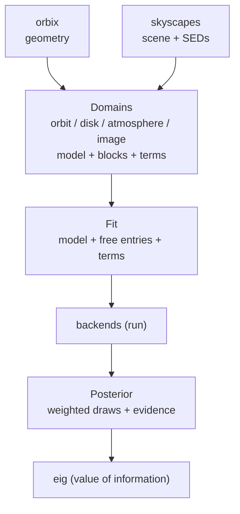

# Architecture

photomancy is a JAX-native engine for Bayesian inference and value of information
over astrophysical scenes observed by direct imaging. orbix builds the geometry and
skyscapes builds the scene, and photomancy divines the scene back from the data:
posteriors over the scene parameters, the Bayesian evidence for model comparison,
and the expected information gain of a candidate next observation. The engine is
forward-model agnostic, so the same inference machinery serves orbit fitting today
and disk, atmosphere, and image-domain fitting as those forward models come online.

For the rigorous treatment behind this overview, the fit, the posterior
approximations, the evidence, and the information gain, see
[Mathematical foundations](mathematical-foundations).

## The core idea: a fit is a density over the free entries of a model

Every fit in photomancy reduces to one scalar function, the log density of a set of
free values. A {py:class}`~photomancy.infer.Fit` builds that function from three things.
The first is a model, an Equinox module whose leaves are arrays: an orbix `System`, a
skyscapes `Scene`, or any module of your own. The second is a dictionary of free entries
that maps the path of a node of the model, such as `"mu"` or `"orbits"`, to its prior. The
third is a tuple of data terms, each of which scores one set of measurements at a model.

The fit evaluates the density in four steps. It takes a dictionary of free values. It
writes them into the model at their paths, which leaves every other node at the value the
model holds. It scores each term at that model. It adds the log prior of the free values
to the sum of the term values. The prior and every term are normalized, so the result is a
normalized joint density of the free values and the data, and its integral over the free
values is the evidence.

The model carries the physics, so a term works on the physically meaningful object, an
orbit or a scene. The backends do not see the model at all. They see the density through
a few methods of the fit: `log_density` on a dictionary of free values, `to_flat` and
`from_flat` between that dictionary and one flat vector, `to_real` and `from_real`
between the stored values and unconstrained ones, and `sample_prior`. This split of
physics from search is the hinge of the library.

A term is an Equinox module that holds its data as array fields. Those arrays stay leaves
of the fit, so JAX traces them as inputs rather than baking them in as compile-time
constants. A forward model that holds a large array, such as a coronagraph
point-spread-function datacube, therefore compiles once and runs over many datasets.

## The layers

photomancy sits between the physics libraries that generate predictions and the domain
code that adapts them into fits. The diagram below traces the data flow of a single fit,
from the external physics, through a domain's terms, into the engine, and out to the
value-of-information layer.



The engine layer is the {py:mod}`photomancy.infer` subpackage and knows no astrophysics.
{py:class}`~photomancy.infer.Fit` and the abstract term types define the density,
{py:mod}`~photomancy.infer.likelihoods` builds normalized likelihoods for gridded data,
{py:mod}`~photomancy.infer.backends` run inference, {py:class}`~photomancy.infer.Posterior`
carries the result behind one type, and {py:mod}`~photomancy.infer.eig` scores candidate
observations as expected information gain. The domain layer supplies the physics-specific
pieces, such as the data terms of `photomancy.measurements` and the orbit blocks, and
depends on the engine, never the reverse.

## The plug-in contract

A domain is a set of plug-ins on the generic engine rather than a parallel stack. To add
a domain, provide a model, a prior over each free node (a `priorities` distribution, or a
block that owns a larger node), and a term for each kind of data. The term is either a
subclass of {py:class}`~photomancy.infer.AbstractTerm` or, when a forward model and a
likelihood are all there is, a {py:class}`~photomancy.infer.ForwardTerm`. The engine
handles the rest: the coordinates, the backends, and the posterior.

The disk fit is the clearest example. photomancy reimplements no disk physics, so the
forward model is the skyscapes surface-brightness render, the likelihood is an independent
Gaussian over the image pixels, and the prior is a weakly informative product over the
fitted geometry. Because the forward model is a field of the term, the same code path
serves a surface-brightness render now and a coronagraph render later without
modification.

### Robust likelihoods

{py:obj}`photomancy.infer.likelihoods` builds the likelihood of a `ForwardTerm` from data,
a per-element `sigma` and an optional boolean `mask` (True uses the element):
`gaussian_loglike`, `laplace_loglike`, `huber_loglike` (Gaussian core, Laplace tails beyond
`delta` sigma) and `student_t_loglike` (heavy tails for unmodeled outliers such as cosmic
rays and hot pixels). Each returns a normalized log density, so evidences compare across
them. In all four `sigma` is the scale of the standardized residual, as in `scipy.stats`,
which for Laplace and Student-t is not the standard deviation. Masked elements contribute
exactly zero to the value and the gradient, even where the data or `sigma` are NaN there.

For correlated residuals, {py:func}`~photomancy.infer.likelihoods.low_rank_gaussian_loglike`
builds a {py:class}`~photomancy.infer.likelihoods.LowRankGaussianLogLikelihood` with covariance
`diag(sigma**2) + basis @ basis.T`. The basis is shared between images; unit Gaussian
coefficients are marginalized independently for each image. Its `solve` method applies
the masked inverse covariance, and `posterior_term` returns the conditional mean of
the low-rank residual. {py:func}`~photomancy.infer.likelihoods.residual_basis` constructs an
uncentered basis from a stack of already-normalized residual images. Both preparation
steps run outside JAX tracing; the resulting likelihood supports JIT and derivatives.

A `ForwardTerm` takes the likelihood as a field, so changing the noise model changes one
argument. The fit below scores the same prediction under a Gaussian and under a Huber
likelihood, with the last pixel masked as a hot pixel.

```python
import equinox as eqx
import jax
import jax.numpy as jnp
from priorities import Normal

from photomancy.infer import Fit, ForwardTerm
from photomancy.infer.likelihoods import gaussian_loglike, huber_loglike

jax.config.update("jax_enable_x64", True)


class Scene(eqx.Module):
    flux: jax.Array


class Identity(eqx.Module):
    def __call__(self, scene):
        return scene.flux


data = jnp.array([1.0, 2.0, 3.0, 50.0])  # the last pixel is a hot pixel
mask = jnp.array([True, True, True, False])
scene = Scene(flux=jnp.zeros(4))
free = {"flux": Normal(jnp.zeros(4), 10.0 * jnp.ones(4))}

fits = [
    Fit(scene, free, (ForwardTerm(Identity(), build(data, 0.5, mask)),))
    for build in (gaussian_loglike, huber_loglike)
]
for fit in fits:
    assert fit.log_density({"flux": data}) > fit.log_density({"flux": jnp.zeros(4)})
```

## Backends and the unified posterior

A backend is an Equinox configuration object, and `run(fit, backend, key)` returns a
`Posterior`. A backend sees the density through the methods of the fit and never the
forward model, which keeps a new sampler useful to every domain at once. Nine backends
exist today:

- {py:obj}`~photomancy.infer.Importance`: importance sampling from one proposal, with the
  evidence from the mean weight. {py:obj}`~photomancy.infer.AdaptiveImportance` refits a
  Gaussian mixture proposal to the weighted draws over several rounds.
- {py:obj}`~photomancy.infer.Laplace`: a Gaussian at each mode, found by L-BFGS from several
  starts, with the inverse Hessian as covariance. The draws are importance weighted to the
  fit, so the result is a posterior with an evidence rather than a Gaussian
  approximation, and several modes make a mixture that covers period aliases.
- {py:obj}`~photomancy.infer.Pathfinder`: quasi-Newton variational inference, a Gaussian
  fitted along the L-BFGS trajectory toward the mode, importance weighted to the fit. It is
  steadier than a single Hessian when a mode is poorly conditioned.
- {py:obj}`~photomancy.infer.NUTS`: the No-U-Turn sampler with window adaptation, returning
  equally weighted draws and no evidence.
- {py:obj}`~photomancy.infer.MCLMC`: microcanonical Langevin Monte Carlo, a gradient-based
  sampler often cheaper per effective sample than NUTS in high dimension, with no evidence.
- {py:obj}`~photomancy.infer.NestedSampling`: jaxns nested sampling, which returns a
  posterior and the evidence for model comparison and detection significance, the Bayes
  factor that answers a question such as whether a given molecule is present.
- {py:obj}`~photomancy.infer.Grid`: quadrature on a product grid, for a fit with few free
  coordinates, with the evidence but no standard error.
- {py:obj}`~photomancy.infer.MAP`: a staged gradient fit that frees named groups of free
  entries stage by stage and carries optimizer states across stages. The result is one
  draw at the optimum with no evidence. [Fit a model in stages](../how-to/staged-map-fit)
  describes it.

Every backend returns the same type, {py:class}`~photomancy.infer.Posterior`: a cloud of
draws in `samples`, their normalized `log_weights`, the fit's own density at each draw in
`log_target`, the `log_evidence` and its `log_evidence_se`, the `fit` itself, and the
backend's own diagnostics in `info`. A backend that has no evidence estimator, or that
refuses its estimate because a validity check failed, returns NaN rather than a wrong
number. Consumers such as the value-of-information layer read this type and stay agnostic
to which backend produced the result. Because the fit rides along, any quantity of the
model can be read at every draw with `model_at` and `forecast`.

New data fold into a posterior without a fresh fit. `Posterior.append_term` and
`Posterior.replace_term` reweight the stored draws by the new term under a gate on the
effective sample size and the Pareto k-hat of the new weights, and
{py:func}`~photomancy.infer.update` refits only where that gate refuses. A fit on one batch
of data therefore feeds the next, and information accumulates across observations.

Nested sampling works on the unit cube. It maps each live point to the free entries
through the inverse cumulative distribution function of each leaf law and the unit-cube
map of each block, `Fit.from_unit`, with no tensorflow-probability dependency. Orbit
fitting runs through the same density and returns the same `Posterior` as every other fit.

## Design principles

The architecture follows a small number of commitments that should guide future
development.

photomancy does inference, not physics. The forward models live in orbix and skyscapes,
and the engine stays forward-model agnostic so that an improvement to a sampler or to the
value-of-information calculation benefits every domain.

A fit is a normalized density over the free entries of a model. The model carries the
physics and the free values carry the search position, and the arrays of a term trace
through the compiled kernel rather than baking in, which keeps large-array forward models
compilable.

One posterior type serves every backend. Backends are interchangeable behind `run`,
and results are interchangeable as a `Posterior`, which makes the backend menu composable.

The prior layer is tensorflow-probability free. Generic distributions come from the
`priorities` library, where each has a closed-form inverse cumulative distribution function,
so one definition serves the gradient, sample, and unit-cube needs of every backend. The
orbit priors are orbit laws of orbix (`orbix.system.OrbitLaw`), held by the orbit blocks.

Domains compose on the generic engine rather than forming parallel stacks. When a domain
grows its own copy of the inference machinery, that copy drifts from the engine and the
two diverge, so a domain should instead supply a model, priors and terms and consume the
shared backends, posteriors, and value-of-information layer.

The engine produces value of information alongside the posterior and the evidence. Every
candidate observation is scored as the expected information gain about a declared
quantity of interest, assembled from analytic per-mode Gaussian gains and exact discrete
terms, and each term saturates as its question settles, which is what lets the score
allocate a finite observing budget. The evidence is the complementary certificate: scores
saturate and rank the next observation, certificates harden and decide when to stop and
announce, and the two roles never swap.

The library is Equinox-first and respects JAX discipline. Stateful objects are
`eqx.Module` subclasses, functions are pure, and float64 is used where the inference
precision requires it.

## Roadmap

The near-term direction extends the engine across more of the scene and scales up its
throughput, without changing the core contract.

On the domain side, orbit fitting is implemented across radial-velocity, astrometry, and
imaging data, disk fitting rides the scene engine, atmospheric retrieval is in progress,
and image-domain fitting against a coronagraph forward is the next major target. Each
arrives as plug-ins on the existing engine.

On the backend side the menu is already broad enough that the gradient and nested samplers
recover the curved, degenerate posteriors that arise in atmospheric retrieval, so the
near-term work is throughput rather than new samplers, with many-chain GPU sampling once the
workloads move to GPU.

A separate, longer-term direction is amortized inference. Where a full sampler is too slow to
run across a large simulated target list, a conditional normalizing flow trained once over
simulated scene-and-data pairs gives an instant posterior for each new dataset. This is
simulation-based rather than likelihood-based, so it does not fit the backend contract, which
takes a fit; it enters as a separate inference modality alongside the backends, feeding
the same `Posterior` and the same value-of-information layer.

The evidence-bearing backends turn the engine toward model comparison and detection:
quantifying whether a planet is present against a null, resolving period aliases, and
assessing the significance of a spectral feature. Combined with the value-of-information
layer, the longer arc is a closed loop in which the engine fits the current data, scores
the candidate next observations, and recommends where to look next.
