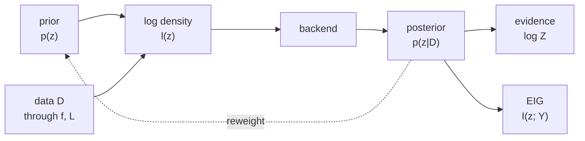

# Glossary

photomancy borrows several words from JAX and Equinox and gives a few of its own a specific
meaning. This page collects the vocabulary that runs through the rest of the documentation,
so that terms like leaf, model, and free entry are unambiguous when they appear in the
[architecture overview](architecture), the [mathematical foundations](mathematical-foundations),
and the example notebooks. Each term carries the symbol used for it in the formulas, so the
notation here is the same notation as the [mathematical foundations](mathematical-foundations).

The map below places the central symbols on the path a fit actually takes, from a prior and
some data, through the fit's density and a backend, to a posterior and the quantities read off
it.



## The model and its parts

```{glossary}
PyTree
   The structural backbone of everything photomancy fits. A
   [PyTree](https://docs.jax.dev/en/latest/pytrees.html) is JAX's name for a nested
   structure of containers, tuples, lists, dictionaries, and Equinox modules, with arrays at
   the tips. JAX transformations walk this structure automatically, so a whole model can be
   passed around, differentiated, and mapped over a batch with `jax.vmap`, all as a single
   object.

Leaf
   One of those tips, an [array or scalar](https://docs.jax.dev/en/latest/pytrees.html) that
   JAX treats as data rather than structure. A free entry of a fit is a leaf or a node made
   of leaves, and the free values flattened and concatenated together form the parameter
   vector $z$, while the rest of the model stays fixed.

Model
   $S$. The object being fit, expressed as a {term}`PyTree`, almost always an
   [`eqx.Module`](https://docs.kidger.site/equinox/api/module/module/). Its array leaves
   are the physical quantities, an orbit's elements, a disk's geometry, an atmosphere's
   abundances, and the engine never needs to know which is which. A node is named by a
   dotted path such as `"mu"` or `"dynamics.orbits"`. Swapping the model and its
   {term}`term` is the whole of moving from one domain to another.

Free entry
   One path of the {term}`model` that the fit may change, together with its {term}`prior`.
   The `free` dictionary of a {py:class}`~photomancy.infer.Fit` maps each path to a
   `priorities` distribution over the whole leaf, or to a block that owns a larger node.
   Every path that is not in the dictionary keeps the value it has in the model.

Static and dynamic
   [Equinox sorts](https://docs.kidger.site/equinox/all-of-equinox/) a module's fields into
   dynamic leaves, the JAX arrays that inference can touch, and static fields, the Python
   values like names and option flags that define structure and trigger recompilation when
   they change. Only dynamic leaves can be free.

z-space
   $z$. The flat vector the samplers actually see. `Fit.to_flat` flattens and concatenates
   the free values into a single one-dimensional array $z$, and `Fit.from_flat` reshapes a
   $z$ back into the dictionary of free values. The samplers work in unconstrained
   coordinates, `Fit.to_real` and `Fit.from_real`, where a positive quantity is a real
   number, a log for example. A posterior stores its draws as the dictionary of free
   values, so the named parameters are always at hand.
```

## Building a fit

```{glossary}
Term
   A function from a {term}`model` to a normalized log likelihood of one set of held data,
   $\log p(D_i \mid z)$. A {py:class}`~photomancy.infer.ForwardTerm` pairs a
   {term}`forward model` with a likelihood, and a term of its own can score any data it
   holds. The sum of the terms is the data part of the {term}`log density`.

Forward model
   $f$. A pure function from a {term}`model` to predicted data, $f(S)$, the map from
   parameters to what the instrument would measure. It carries all the physics, and the
   engine treats it as a black box. A forward model is an Equinox module, so the arrays it
   holds stay leaves of the term and are traced rather than compiled in.

Likelihood
   $L$. A function from predicted data to a scalar log-likelihood,
   $\log p(D \mid z) = \log L\big(f(S)\big)$, scoring how well a prediction matches the
   observation $D$ under the noise model. Forward model and likelihood are kept separate so
   the same physics can be reused with different noise assumptions.

Prior
   $p(z)$. What is known about the parameters before the data. The prior of a
   {term}`free entry` is a distribution from the `priorities` library or a block, and a
   {term}`posterior` becomes the next prior in effect when a new term reweights it, which is
   how beliefs carry forward across observations.

Log density
   $\ell(z) = \log p(D \mid z) + \log p(z)$. The normalized log joint density of the free
   values and the data, the sum of the {term}`prior` and the {term}`term` values.
   `Fit.log_density` evaluates it on a dictionary of free values. Because every piece is
   normalized, its integral over $z$ is the {term}`evidence`.

Domain
   A packaged set of pieces, a {term}`forward model`, {term}`terms <term>`, and sensible
   priors, for one kind of problem. The orbit, disk, and atmosphere domains, built on
   [orbix](https://github.com/CoreySpohn/orbix) geometry and
   [skyscapes](https://github.com/CoreySpohn/skyscapes) scenes, let a typical fit call one
   helper rather than wiring the pieces by hand.
```

## Running a fit

```{glossary}
Backend
   An inference algorithm with a uniform interface: give `run` a `Fit`, a backend and a
   key, and it returns a {term}`posterior`. The menu runs from the fast
   {term}`Laplace approximation` and importance sampling through the
   [BlackJAX](https://blackjax-devs.github.io/blackjax/) No-U-Turn sampler to nested
   sampling via [jaxns](https://jaxns.readthedocs.io/en/latest/), so the same fit can be
   run cheaply for a first look or rigorously when the evidence matters.

Posterior
   $p(z \mid D)$. The belief after fitting, the distribution over the free values given the
   data, held as a cloud of weighted draws: `samples`, `log_weights`, `log_target`,
   `log_evidence`, `log_evidence_se`, and the `fit`. Whatever backend produced it, it is one
   type, so downstream code does not depend on how it was computed.

MAP
   $z_\star = \arg\max_z \ell(z)$. The maximum a posteriori point, the location of highest
   posterior density. The `MAP` backend climbs to it in stages and returns it as a single
   draw with no evidence, and the {term}`Laplace approximation` climbs to it before
   measuring the curvature around it.

Laplace approximation
   $\mathcal{N}(z_\star, \Sigma)$ with $\Sigma = H^{-1}$. A Gaussian fit to a {term}`mode`,
   taking the {term}`MAP` as the mean and the inverse Hessian $H = -\nabla^2 \ell(z_\star)$
   as the covariance. The `Laplace` backend uses it as a proposal and weights the draws to
   the fit, so the result is a posterior and an {term}`evidence`, not the Gaussian itself.

Mode
   $\mathcal{N}(z_k, \Sigma_k)$. One peak of the posterior, one self-consistent explanation
   of the data. Multimodal problems, a blindly fit orbit period or a mirror-image source
   position, have several, and a single Gaussian can only sit on one of them.

Mixture
   $\sum_k w_k \mathcal{N}(z_k, \Sigma_k)$. Several {term}`modes <mode>` at once, each weighted
   by its evidence, $w_k \propto e^{\log Z_k}$. The `Laplace` backend builds one as its
   proposal, and `cluster_to_mixture` summarizes the cloud of a `Posterior` as one. It is
   what lets photomancy represent ambiguity honestly instead of collapsing prematurely onto
   one answer.
```

## Comparing and deciding

```{glossary}
Evidence
   $\log Z$. The log marginal likelihood, the probability of the data under a model with its
   parameters integrated out. It rewards fit and penalizes unnecessary flexibility, the
   built-in Occam factor, and every {term}`posterior` carries it as `evidence`.

Bayes factor
   $\log Z_1 - \log Z_0$. The difference of the log evidences of two competing models. It is
   the quantity that decides questions of model comparison, whether an orbit needs
   eccentricity, or whether an oxygen band is really present.

Expected information gain
   $\mathrm{EIG}(Y) = I(z; Y)$. How much a {term}`candidate` observation $Y$ is expected to
   sharpen the belief, the mutual information between the parameters and the observation,
   equivalently the expected reduction in posterior entropy before the data is in hand. It
   is the score photomancy uses to choose where to look next, and the same primitive serves
   every scale, from one exposure to a whole mission.

Candidate
   $Y$. A possible next observation, an epoch, a sensor placement, a wavelength, that the
   {term}`expected information gain` ranks. A candidate is a {term}`term` that holds the
   observation to be made, and {py:obj}`~photomancy.infer.eig_contrastive` and
   {py:obj}`~photomancy.infer.eig_nested` take a posterior and that term and return the
   score as an {py:class}`~photomancy.infer.EIGEstimate`.

Sequential updating
   $B_{k+1}(z) \propto p(D_{k+1} \mid z)\, B_k(z)$. Folding a new observation into the
   running belief by reweighting the current {term}`posterior` with the new {term}`term`, through
   `Posterior.append_term` or `update`, which refits only where the reweighting fails its gate. Repeated, it is how a belief tightens observation by
   observation, and it closes the loop with the {term}`expected information gain` that chose
   each observation.
```

## Upstream documentation

The libraries photomancy builds on, for the terms borrowed from them:

- [JAX](https://docs.jax.dev/en/latest/pytrees.html) -- pytrees and leaves, and the
  transformations the engine runs on them.
- [Equinox](https://docs.kidger.site/equinox/all-of-equinox/) -- modules, and the filtering
  that partitions a scene into fitted and static parts.
- [BlackJAX](https://blackjax-devs.github.io/blackjax/) -- the No-U-Turn and sequential
  Monte Carlo samplers behind those backends.
- [jaxns](https://jaxns.readthedocs.io/en/latest/) -- nested sampling and the evidence it
  integrates.
- [orbix](https://github.com/CoreySpohn/orbix) -- the orbital geometry behind the orbit
  domain.
- [skyscapes](https://github.com/CoreySpohn/skyscapes) -- the scene and reflected-light
  models behind the disk and atmosphere domains.
